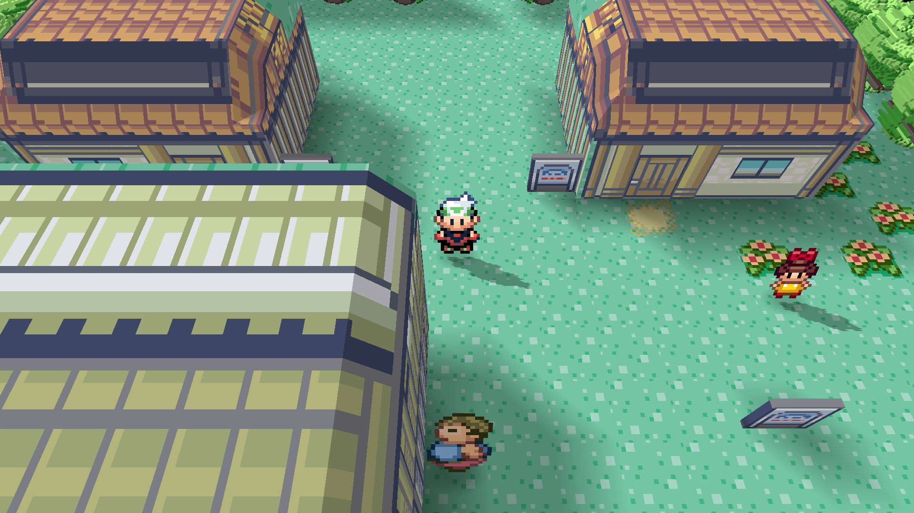
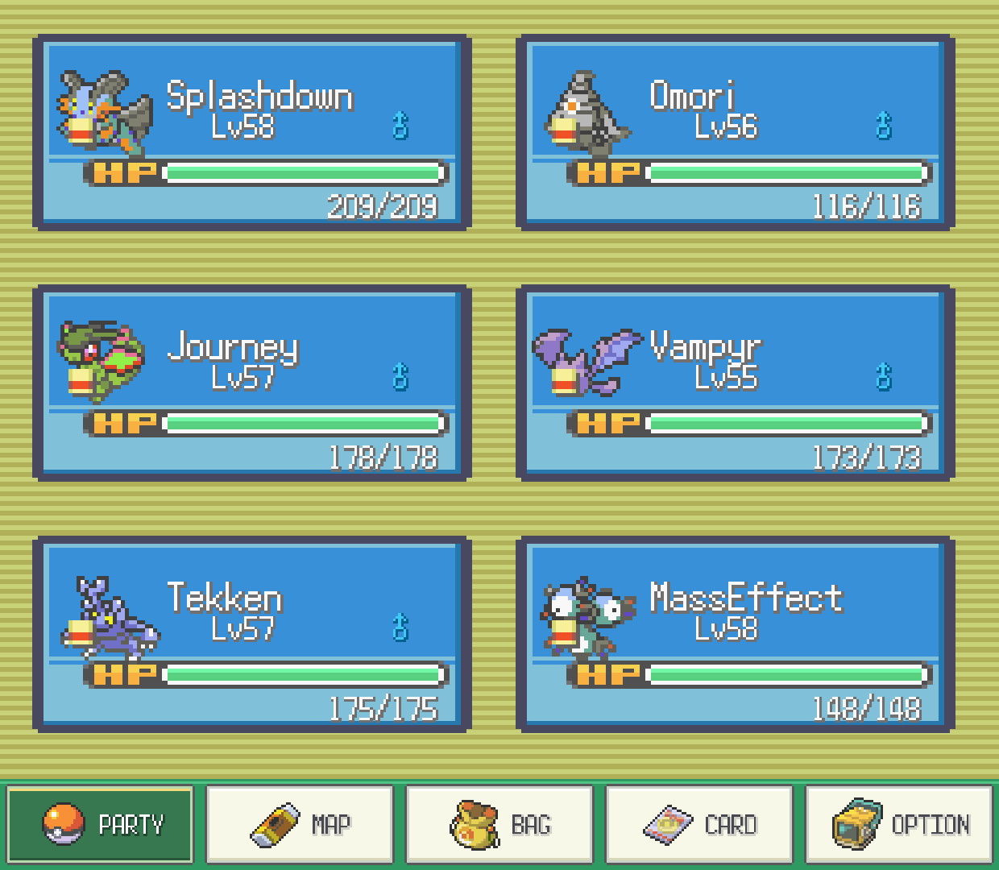
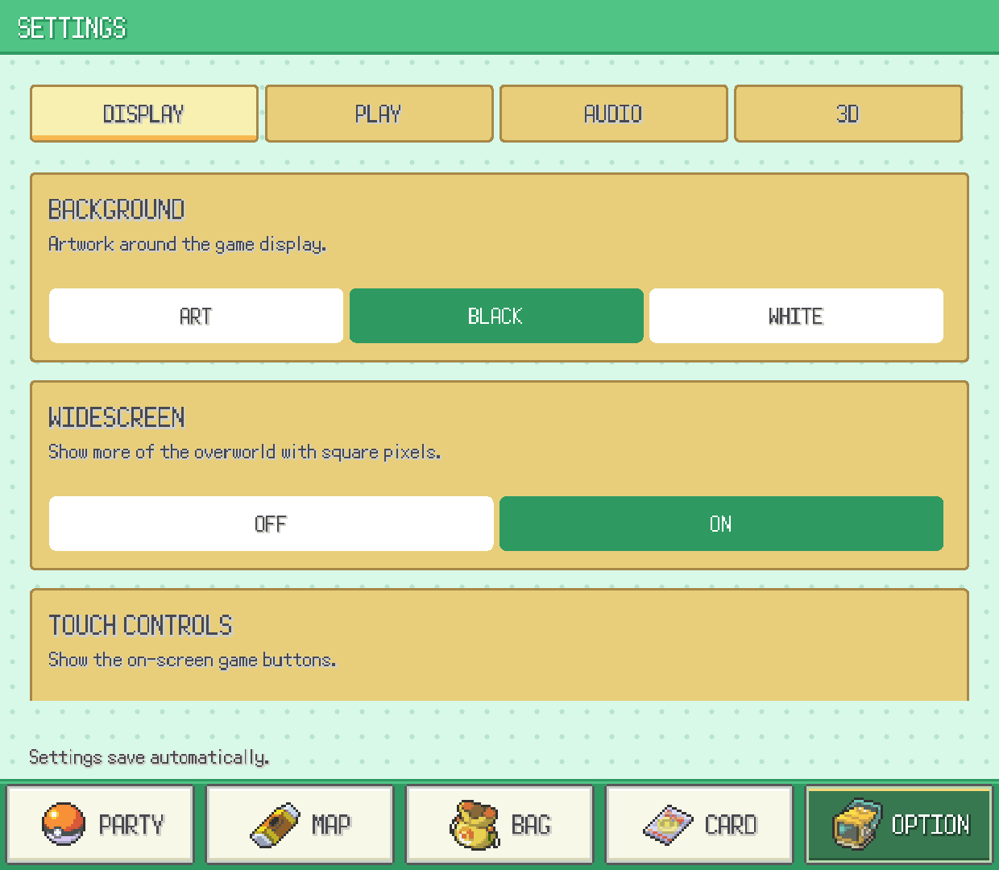

  

<h1 align="center">Pokémon Emerald Dual Screen</h1>

  Pokémon Emerald for dual-screen Android handhelds. 
  Widescreen gameplay on top, touch menus below.

  <a href="https://github.com/Goldoire/pokeemerald-dualscreen/releases/latest">Download</a> ·
  <a href="#screenshots">Screenshots</a> ·
  <a href="#features">Features</a> ·
  <a href="#getting-started">Getting started</a> ·
  <a href="#documentation">Documentation</a>

A native Android port of Pokémon Emerald, built for dual-screen handhelds such as the AYN Thor. Play on the top display while checking your party, map and bag—or choosing your next move—on the bottom display.

You'll need your own Pokémon Emerald (USA/Europe) ROM. Select it when you first open the app.

## Screenshots

Each pair shows the game on the top display and its matching touch screen below.

<table>
  <tr>
    <td align="center"><strong>Widescreen and map</strong>  </td>
    <td align="center"><strong>Battle menus</strong>  </td>
  </tr>
</table>

<strong>More screenshots</strong>

<table>
  <tr>
    <td align="center"><strong>Moves</strong>  </td>
    <td align="center"><strong>Party</strong>  </td>
  </tr>
  <tr>
    <td align="center"><strong>Battle bag</strong>  </td>
    <td align="center"><strong>Trainer card</strong>  </td>
  </tr>
  <tr>
    <td align="center"><strong>3D view</strong>  </td>
    <td align="center"><strong>Settings</strong>  </td>
  </tr>
</table>

## Features

| Feature | Description |
| --- | --- |
| Widescreen | See more of the map without stretching the picture. |
| Touch battles | Pick moves, use items and switch Pokémon from the bottom screen. |
| Party | Check HP, status, stats and moves without opening the game's menu. |
| Map, bag and trainer card | Browse Hoenn, check your items and view your trainer card. |
| Fast-forward | Speed up the game to 2×, 3× or 4×. Music can stay at normal speed. |
| 3D view | Try the voxel renderer with adjustable camera angle, zoom and lighting. |
| Controls | Touch controls and physical buttons work throughout the battle menus. |

3D mode is experimental. Open **OPTION → 3D** to change the renderer and camera. The [settings guide](docs/SETTINGS.md) explains the options.

## Getting started

1. Download and install the APK from the [latest release](https://github.com/Goldoire/pokeemerald-dualscreen/releases/latest).
2. Launch the app, tap **Select ROM**, and choose your own Pokémon Emerald (USA/Europe) ROM.
3. Let the app prepare its game data. Future launches open directly into the game.

Already have a save? You can import a **128 KB GBA save file**. See [install and saves](docs/INSTALLATION.md) for the steps. The app supports the original USA/Europe ROM; patched ROMs and ROM hacks won't work with the ROM picker.

## Documentation

| Guide | Description |
| --- | --- |
| [Install and saves](docs/INSTALLATION.md) | Installation, updates, save imports and backups. |
| [Settings](docs/SETTINGS.md) | Display, controls, sound and 3D options. |
| [Build from source](docs/DEVELOPMENT.md) | Build your own Android APK. |
| [Run on PC](docs/EMULATOR.md) | Run the Android app in a dual-screen emulator. |

## Credits

Based on [pret/pokeemerald](https://github.com/pret/pokeemerald) and [gradenGnostic's native port](https://github.com/gradenGnostic/pokeemerald-multiplatform). More thanks and source credits are in [Credits](docs/CREDITS.md).

Unofficial fan project. Pokémon belongs to its respective owners. [License](LICENSE).
