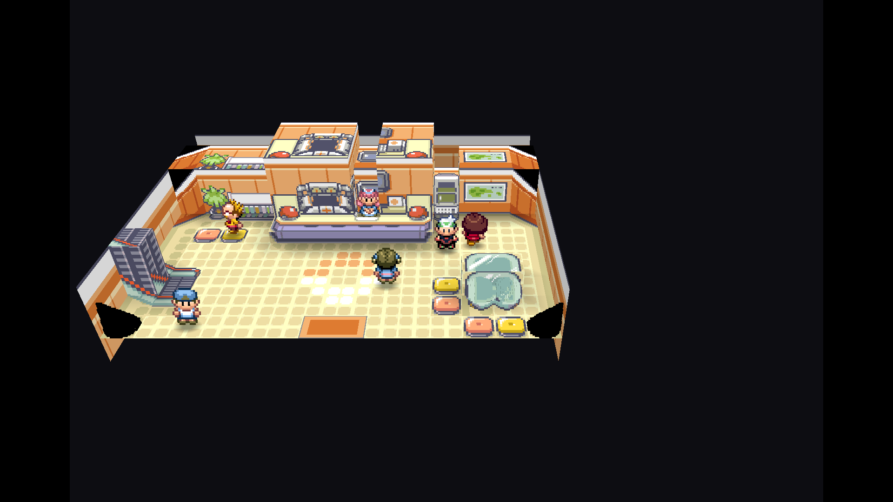
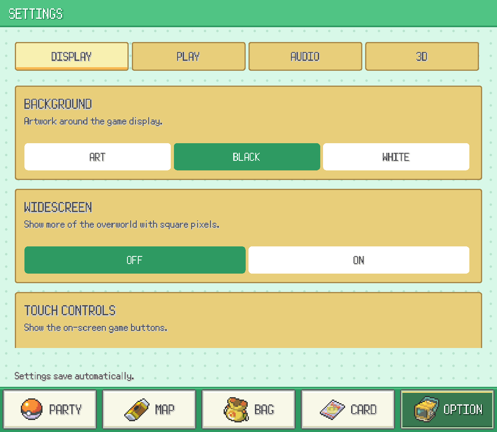

  

<h1 align="center">Pokémon Emerald Dual Screen</h1>

  <strong>Emerald on top. Your adventure at your fingertips below.</strong> 
  A native Android port for the AYN Thor and other dual-screen devices.

  <a href="https://github.com/Goldoire/pokeemerald-dualscreen/releases/latest">Download</a> ·
  <a href="#screenshots">Screenshots</a> ·
  <a href="#features">Features</a> ·
  <a href="#getting-started">Getting started</a> ·
  <a href="#in-development">In development</a> ·
  <a href="#documentation">Documentation</a>

Play the original Emerald adventure with a native widescreen top display and a dedicated touch interface below. Check your party, explore Hoenn, and choose your battle moves without covering the game.

**Bring your own Pokémon Emerald (USA/Europe) ROM.** The app prepares its game data on first launch; no playable ROM is bundled.

## Screenshots

Android captures of the classic renderer and release interface. Each pair shows the top screen above its matching bottom screen.

<table>
  <tr>
    <td align="center"><strong>Widescreen and the Hoenn map</strong>  </td>
    <td align="center"><strong>Dual-screen battles</strong>  </td>
  </tr>
</table>

<strong>More screenshots: moves, party, bag, and trainer card</strong>

<table>
  <tr>
    <td align="center"><strong>Choose a move</strong>  </td>
    <td align="center"><strong>Your party</strong>  </td>
  </tr>
  <tr>
    <td align="center"><strong>Use a battle item</strong>  </td>
    <td align="center"><strong>Trainer card</strong>  </td>
  </tr>
</table>

## Features

| Feature | What you can do |
| --- | --- |
| Native widescreen | Reveals more of the overworld on the top display, with square pixels. |
| Touch battles | Gen 4-style battle commands, move selection, bag use, and party switching on the bottom display. |
| Live party | Icons, HP, status, and a detail view with stats, nature, ability, moves, and experience. |
| Hoenn map | Live position and location name on the PokéNav region map. |
| Bag and trainer card | All five pockets with quantities; badges, money, and play time. |
| Fast-forward | 2×, 3×, or 4×, with an option to keep music at its normal tempo. |
| Optional battle hints | Move effectiveness and opponent weaknesses; off by default. |
| Touch or gamepad | Use the lower display or supported controller inputs. |

## Getting started

1. Download and install the APK from the [latest release](https://github.com/Goldoire/pokeemerald-dualscreen/releases/latest).
2. Launch the app, tap **Select ROM**, and choose your own Pokémon Emerald (USA/Europe) ROM.
3. Let the app reconstruct its game data. This happens once; future launches boot into the game.

Already have a save? Import an ordinary **128 KB GBA flash save** and continue your adventure. See the [install and save guide](docs/INSTALLATION.md) for the supported ROM checksum, file locations, updates, and backups. Patched ROMs and ROM hacks are not supported by the release's ROM picker.

## In development

**These previews are from local development builds, not the published v0.5.0 APK.** Handheld validation is still underway.

- **Pokémon-style navigation:** game sprites, pixel frames, and a clearer selected tab.
- **Grouped settings:** Display, Play, Audio, and 3D sections.
- **Experimental voxel world:** 3D terrain, trees, buildings, and battles staged on the map.
- **Camera and lighting controls:** live angle/zoom, an independent voxel-battle option, and opt-in SUN lighting with terrain and character shadows.

<strong>Preview the voxel renderer and new bottom-screen UI</strong>

   
  

Actual paired captures from the Android app running in the PC dual-screen emulator. The voxel renderer is experimental; map coverage, camera framing, and handheld performance are still being checked.

See the [settings guide](docs/SETTINGS.md) for controls and the [lighting notes](docs/VOXEL_LIGHTING.md) for validation. The [3DS comparison](docs/ZALLAX_COMPARISON.md) and [feasibility report](docs/IMPLEMENTATION_FEASIBILITY.md) track the remaining renderer work.

## Documentation

| Guide | What's inside |
| --- | --- |
| [Install and saves](docs/INSTALLATION.md) | ROM setup, updates, save imports, and backups. |
| [Build from source](docs/DEVELOPMENT.md) | Android prerequisites, SDL2 setup, and APK packaging. |
| [Android emulator on PC](docs/EMULATOR.md) | Run the actual app with two displays and test touch input. |
| [Development settings](docs/SETTINGS.md) | Display, play, audio, camera, and lighting options. |
| [Voxel lighting](docs/VOXEL_LIGHTING.md) | Renderer changes, checks, and device testing still needed. |

Developer tools: [mod tooling](docs/MODDING.md) · [decomp-project importer](docs/IMPORTER.md) · [original GBA build instructions](INSTALL.md). These tools do not add arbitrary ROM-hack support to the Android release.

## Credits

- [pret/pokeemerald](https://github.com/pret/pokeemerald): Pokémon Emerald decompilation.
- [gradenGnostic/pokeemerald-multiplatform](https://github.com/gradenGnostic/pokeemerald-multiplatform): native SDL2 port.
- [samyost1/tmc-android](https://github.com/samyost1/tmc-android) and [samyost1/zelda3-android](https://github.com/samyost1/zelda3-android): dual-screen architecture references.
- DramaticShape and UNDERdecodedHD: the DramaticShapes algorithms informing the experimental voxel work.
- [ZallaxDev/pokeemerald-3Ds-dualscreen](https://github.com/ZallaxDev/pokeemerald-3Ds-dualscreen): README and navigation-icon inspiration, plus fixed-sun face-light calculation/constants adapted for the experimental renderer. See the [voxel notice](src/platform/voxel/NOTICE.md).

The project was developed with assistance from Claude Code and other AI coding tools. The header logo was created with image generation using Emerald's title-screen lettering as reference.

Pokémon and Pokémon Emerald belong to their respective owners. This is an unofficial fan project, unaffiliated with Nintendo, Game Freak, Creatures, or The Pokémon Company. See [LICENSE](LICENSE) for the scope of the port's license; upstream code and third-party components retain their own terms.
