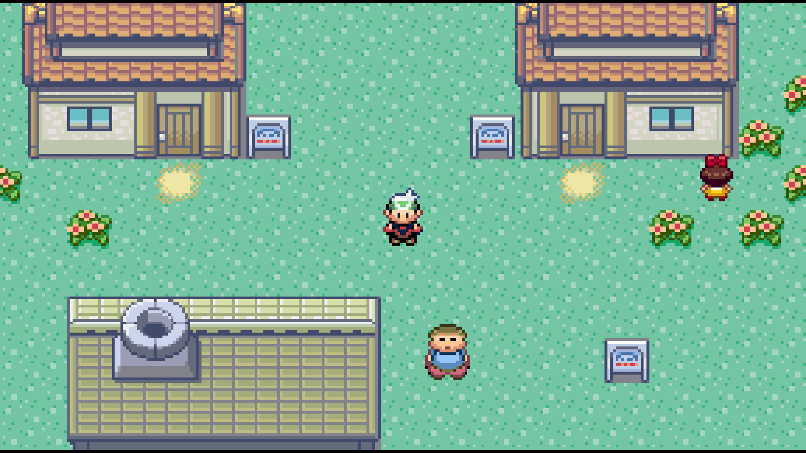
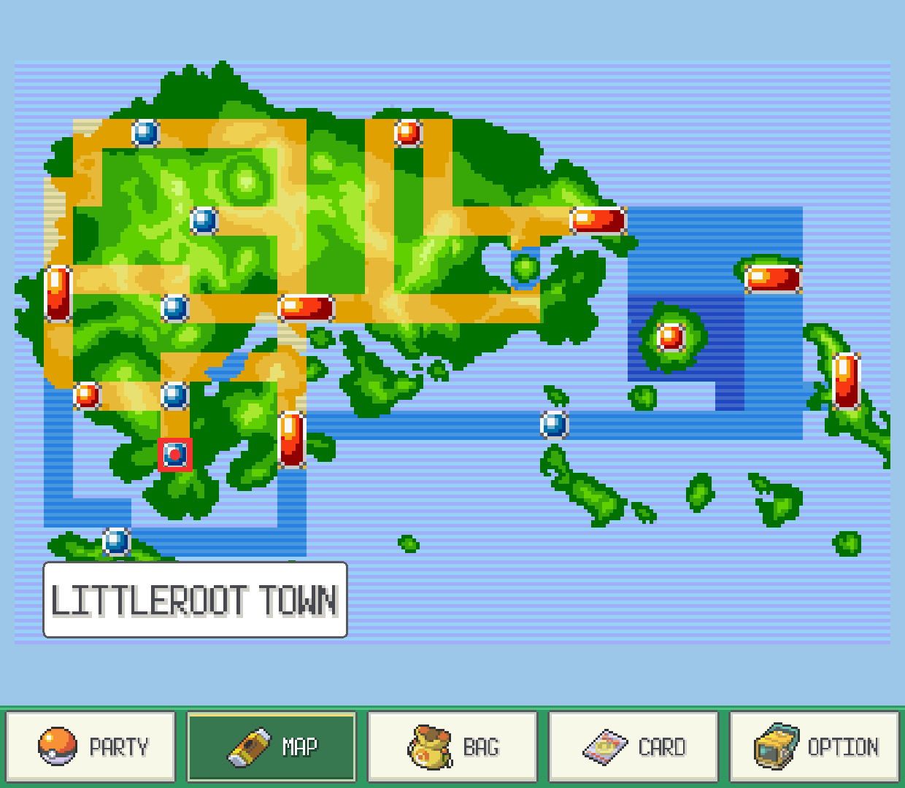
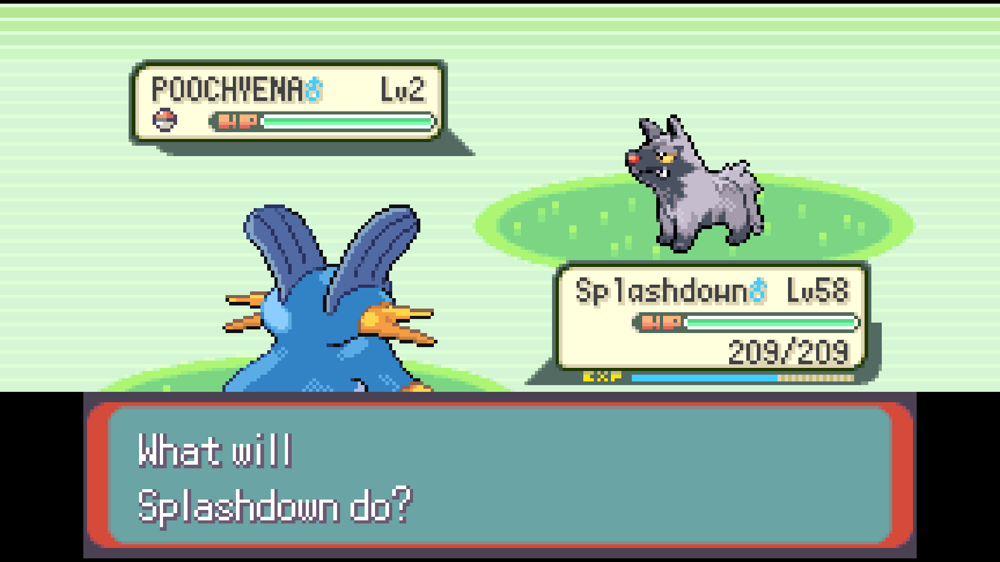
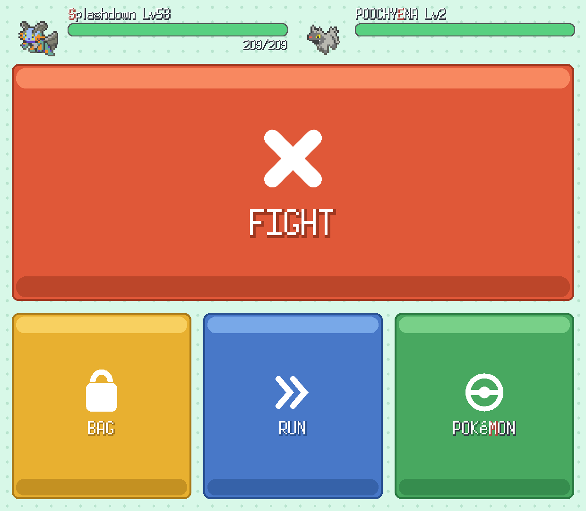
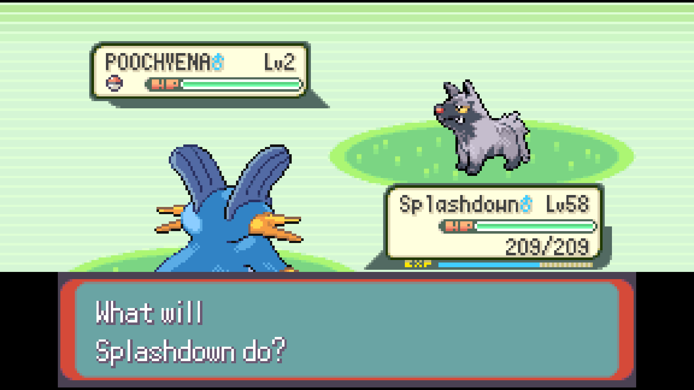
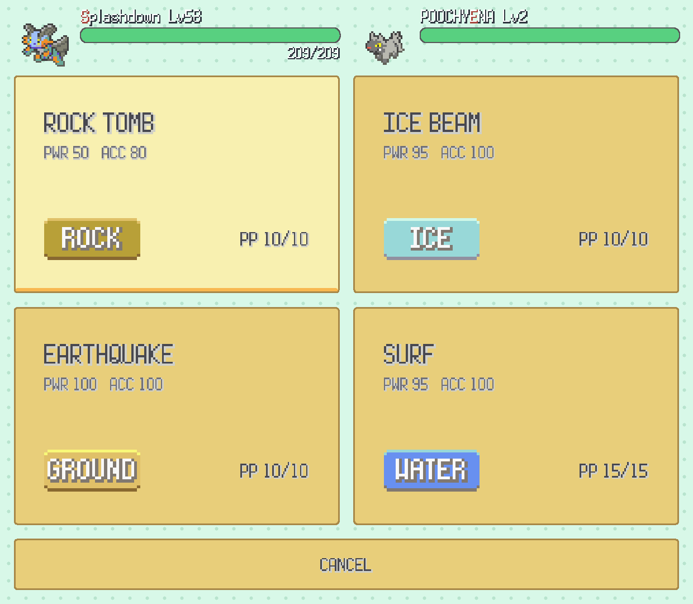
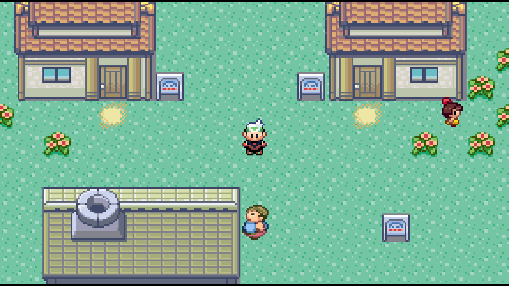
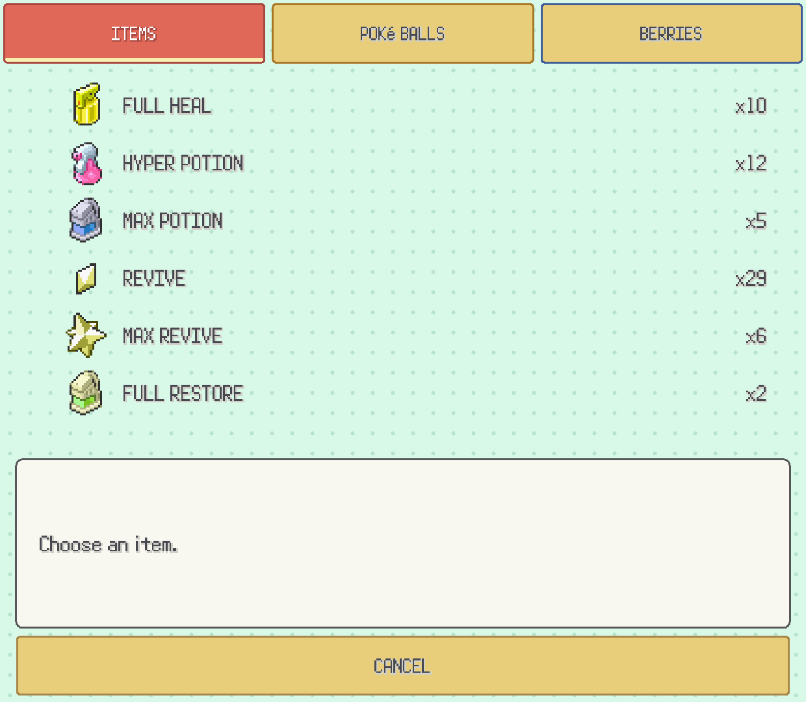
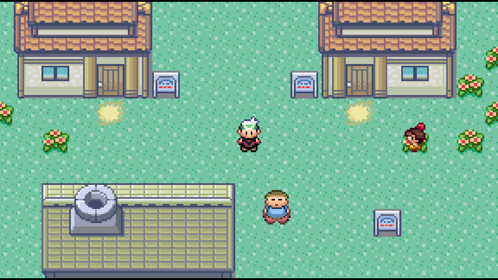
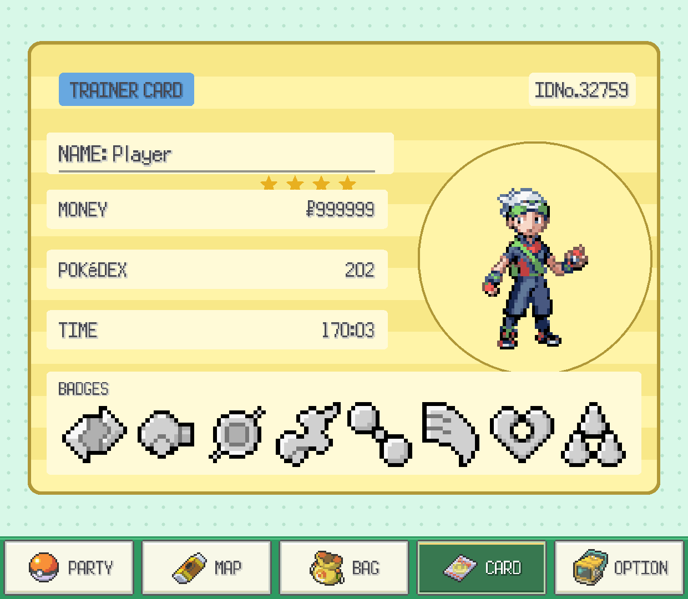

<p align="center">
  
</p>

<h1 align="center">Pokémon Emerald Dual Screen</h1>

<p align="center">
  Emerald on top. Your adventure at your fingertips below.<br>
  A native Android port for the AYN Thor and other dual-screen devices.
</p>

<p align="center">
  <a href="https://github.com/Goldoire/pokeemerald-dualscreen/releases/latest">Download</a> ·
  <a href="#screenshots">Screenshots</a> ·
  <a href="#features">Features</a> ·
  <a href="#getting-started">Getting started</a> ·
  <a href="#saves">Saves</a> ·
  <a href="#experimental-voxel-renderer">Voxel development</a>
</p>

Play the original Emerald adventure with a widescreen top display and a touch interface on the bottom. Check your party, explore the Hoenn map, and choose your battle moves without covering the game. The decompiled game runs natively through SDL2.

The release APK reconstructs the required game data from your own supported Pokémon Emerald ROM on first launch. No playable ROM is bundled. The current Android release supports the original USA/Europe game; patched ROMs and ROM hacks are not supported by its ROM picker.

## Screenshots

Actual captures from the Android app. Each pair shows the top screen above its matching bottom screen.

<table>
  <tr>
    <td align="center"><strong>Widescreen and the Hoenn map</strong><br><br></td>
    <td align="center"><strong>Dual-screen battles</strong><br><br></td>
  </tr>
</table>

<details>
<summary><strong>More screenshots: moves, party, bag, and trainer card</strong></summary>

<table>
  <tr>
    <td align="center"><strong>Choose a move</strong><br><br></td>
    <td align="center"><strong>Your party</strong><br><br></td>
  </tr>
  <tr>
    <td align="center"><strong>Use a battle item</strong><br><br></td>
    <td align="center"><strong>Trainer card</strong><br><br></td>
  </tr>
</table>

</details>

## Features

| Feature | In the Android release |
| --- | --- |
| Native widescreen | Reveals more of the overworld on the top display, with square pixels. |
| Touch battles | Gen 4-style battle commands, move selection, bag use, and party switching on the bottom display. |
| Live party | Icons, HP, status, and a detail view with stats, nature, ability, moves, and experience. |
| Hoenn map | Live position and location name on the PokéNav region map. |
| Bag and trainer card | All five pockets with quantities; badges, money, and play time. |
| Fast-forward | 2×, 3×, or 4×, with an option to keep music at its normal tempo. |
| Optional battle hints | Move effectiveness and opponent weaknesses; off by default. |
| Touch or gamepad | Use the lower display or supported controller inputs. |

## Getting started

1. Download and install the APK from the [latest release](https://github.com/Goldoire/pokeemerald-dualscreen/releases/latest). Allow installation from that source when Android asks.
2. Launch the app, tap **Select ROM**, and choose your own Pokémon Emerald (USA/Europe) ROM.
3. Let the app reconstruct its game data. This happens once; future launches boot into the game.

The supported ROM has SHA-1:

```text
f3ae088181bf583e55daf962a92bb46f4f1d07b7
```

Alternatively, put `baserom.gba` in `Android/data/com.pokeemerald.dualscreen/files/` before launching to skip the picker. Availability of direct access to this folder depends on your Android device and file manager.

## Saves

Bring an ordinary **128 KB GBA flash save** from an emulator or cartridge dumper. Put it at:

```text
Android/data/com.pokeemerald.dualscreen/files/pokeemerald.sav
```

It loads on the next launch. Copy that file out to back it up or transfer it to another device. Emulator savestates are a different format and do not work here. Back up your existing save before replacing it or trying experimental builds.

## Experimental voxel renderer

A separate development branch explores a 3D overworld with shaped terrain, trees, buildings, and battles staged on the map. It is **not part of the current 0.5.0 release**.

Development builds currently have **VOXEL 3D (RESTART)** and **VOXEL CAMERA** settings. These features still need regression testing on the handheld before being included in a release.

The [3DS fork comparison](docs/ZALLAX_COMPARISON.md) reviews candidate improvements from ZallaxDev's implementation, including authored buildings and interiors, fixed-sun shadows, and terrain relief. These are proposals, not features shipped by this APK.

## Development

The Android build uses the 32-bit ARMv7 ABI. See [the build guide](docs/DEVELOPMENT.md) for prerequisites, generated files, SDL2 setup, and APK packaging. [INSTALL.md](INSTALL.md) retains the original GBA decompilation instructions.

The source tree also contains experimental [mod tooling](docs/MODDING.md) and a [decomp-project importer](docs/IMPORTER.md). These tools do not make arbitrary patched ROMs compatible with the Android release.

## Credits

- [pret/pokeemerald](https://github.com/pret/pokeemerald): Pokémon Emerald decompilation.
- [gradenGnostic/pokeemerald-multiplatform](https://github.com/gradenGnostic/pokeemerald-multiplatform): native SDL2 port.
- [samyost1/tmc-android](https://github.com/samyost1/tmc-android) and [samyost1/zelda3-android](https://github.com/samyost1/zelda3-android): dual-screen architecture references.
- DramaticShape and UNDERdecodedHD: the DramaticShapes algorithms informing the experimental voxel work.
- [ZallaxDev/pokeemerald-3Ds-dualscreen](https://github.com/ZallaxDev/pokeemerald-3Ds-dualscreen): inspiration for this README layout and a reference for proposed voxel improvements.

The project was developed with assistance from Claude Code and other AI coding tools. The header logo was created with image generation using Emerald's title-screen lettering as reference.

Pokémon and Pokémon Emerald belong to their respective owners. This is an unofficial fan project, unaffiliated with Nintendo, Game Freak, Creatures, or The Pokémon Company. See [LICENSE](LICENSE) for the scope of the port's license; upstream code and third-party components retain their own terms.
